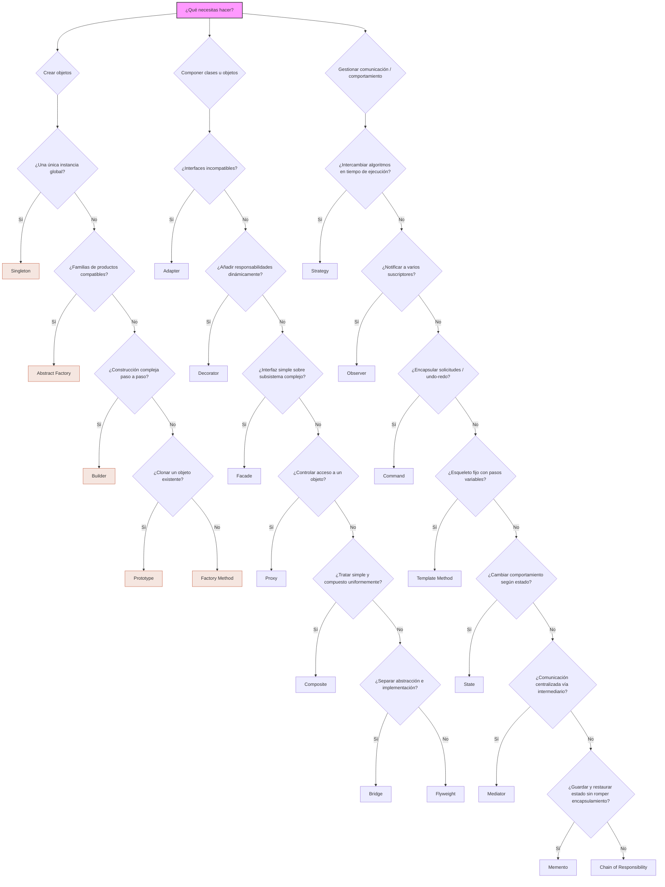
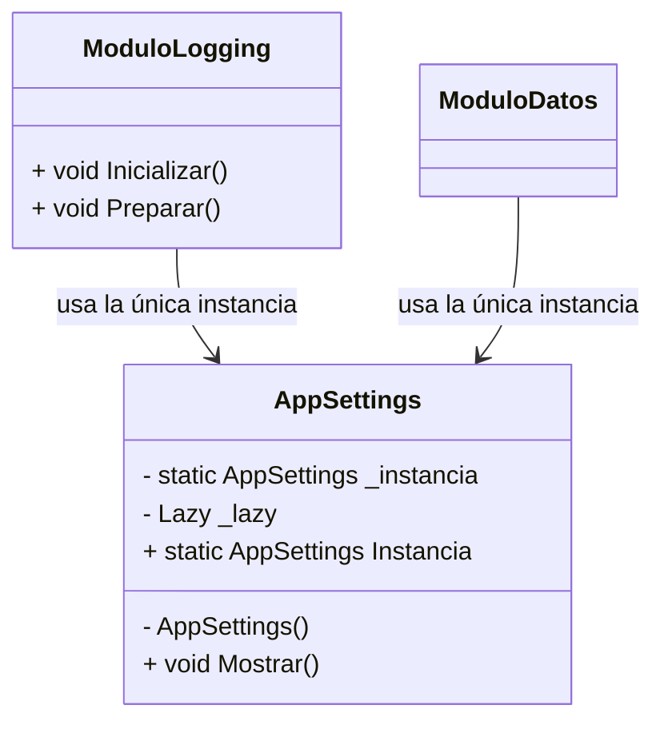
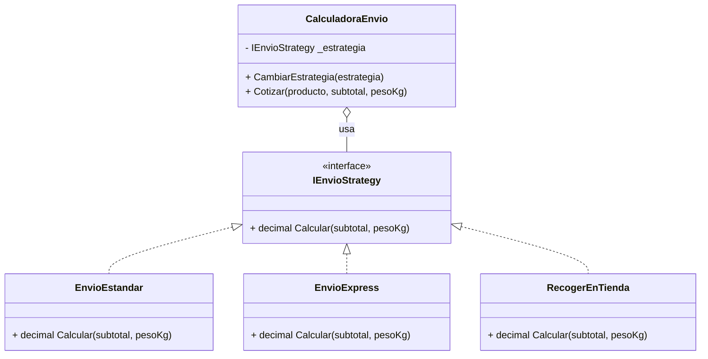

# DesignPatterns — Patrones de Diseño GoF en C#

[](https://dotnet.microsoft.com/download)
[](https://dotnet.microsoft.com/languages)
[](https://github.com/Chienwei82/DesignPatterns)
[](https://github.com/Chienwei82/DesignPatterns)

> **⚠️ Proyecto de aprendizaje personal**
>
> Este repositorio es una **práctica de estudio personal**. No pretende ser una referencia de producción ni un paquete reutilizable; su único objetivo es consolidar conceptos de los patrones de diseño clásicos (Gang of Four) mediante implementaciones sencillas en C#.

---

## ¿Qué es esto?

Una aplicación de consola interactiva en **.NET 10** que demuestra **20 de los 23 patrones de diseño GoF** (Gang of Four), organizados por categoría. Cada patrón incluye su implementación, un caso de uso ilustrativo y documentación interna con **intención, analogía, cuándo usar y cuándo NO usar** —todo en español.

| Categoría | Patrones |
|-----------|----------|
| **Creacionales** (cómo se crean los objetos) | Singleton, Factory Method, Abstract Factory, Builder, Prototype |
| **Estructurales** (cómo se componen las clases) | Adapter, Decorator, Facade, Proxy, Composite, Bridge, Flyweight |
| **De Comportamiento** (cómo se comunican los objetos) | Strategy, Observer, Command, Template Method, State, Mediator, Memento, Chain of Responsibility |

> **Nota:** los 23 patrones GoF originales incluyen también **Interpreter**, **Iterator** y **Visitor**. Se omiten a propósito: Iterator y Visitor ya los cubre C# (`IEnumerable`/LINQ), y Interpreter es raro en la práctica.

---

## Tabla rápida de patrones

| # | Patrón | Categoría | Intención en una frase | Analogía |
|---|--------|-----------|------------------------|----------|
| 1 | Singleton | Creacional | Una sola instancia global, punto de acceso único | Configuración global de la app: solo hay una |
| 2 | Factory Method | Creacional | Delegar la creación de objetos a subclases | App de delivery: cada repartidor elige su transporte |
| 3 | Abstract Factory | Creacional | Crear familias de objetos compatibles | Tema visual de UI: todos los componentes combinan |
| 4 | Builder | Creacional | Construcción paso a paso de objetos complejos | Constructor de consultas SQL: SELECT, FROM, WHERE... |
| 5 | Prototype | Creacional | Clonar objetos existentes en vez de crear desde cero | Fotocopia de un documento prellenado |
| 6 | Adapter | Estructural | Hacer compatibles interfaces incompatibles | Pasarela de pago: Stripe ↔ PayPal con la misma interfaz |
| 7 | Decorator | Estructural | Añadir responsabilidades dinámicamente | Notificaciones: email + retraso + reintento + bitácora |
| 8 | Facade | Estructural | Interfaz simple sobre un subsistema complejo | Compra online: un solo método orquesta 4 subsistemas |
| 9 | Proxy | Estructural | Controlar el acceso a un objeto | Repositorio de datos: caché + permisos antes de la BD |
| 10 | Composite | Estructural | Tratar individuales y compuestos de forma uniforme | Sistema de archivos: archivos y directorios |
| 11 | Bridge | Estructural | Separar abstracción de implementación | Gráficos × renderizadores (PNG/SVG/Consola) |
| 12 | Flyweight | Estructural | Compartir objetos en gran cantidad | Juego 2D: 1,000 tiles con 3 sprites compartidos |
| 13 | Strategy | Comportamiento | Algoritmos intercambiables en tiempo de ejecución | Envío: Estándar, Express o Recoger en tienda |
| 14 | Observer | Comportamiento | Notificar a suscriptores cuando cambia el estado | Eventos de dominio: OrderService notifica a suscriptores |
| 15 | Command | Comportamiento | Encapsular solicitudes como objetos (undo/redo) | Editor de texto: insertar y borrar líneas con undo/redo |
| 16 | Template Method | Comportamiento | Esqueleto fijo de algoritmo, pasos variables | Pipeline de datos: Extraer → Transformar → Cargar |
| 17 | State | Comportamiento | Cambiar comportamiento según el estado interno | Ciclo de vida de un pedido: Recibido → Enviado → Entregado |
| 18 | Mediator | Comportamiento | Comunicación centralizada mediante intermediario | Chat room: todos hablan a través del mediador |
| 19 | Memento | Comportamiento | Guardar y restaurar estado sin romper encapsulamiento | Editor con checkpoints: guardar y restaurar versiones |
| 20 | Chain of Responsibility | Comportamiento | Pasar una solicitud por una cadena de manejadores | Soporte: Nivel 1 → Nivel 2 → Gerente → Director |

---

## Mapa visual de los patrones

```mermaid
graph TD
    %% Estilos por familia
    classDef creacional fill:#f5e6e0,stroke:#c45a3d,stroke-width:2px,color:#1d1b18;
    classDef estructural fill:#e0eaf5,stroke:#3d7ac4,stroke-width:2px,color:#1d1b18;
    classDef comportamiento fill:#dff0e2,stroke:#3d8b4a,stroke-width:2px,color:#1d1b18;

    GOF[Patrones GoF<br/>20 de 23 implementados]

    GOF --> C[Creacionales<br/>5 patrones]
    GOF --> E[Estructurales<br/>7 patrones]
    GOF --> B[Comportamiento<br/>8 patrones]

    C --> S1[1 Singleton]
    C --> S2[2 Factory Method]
    C --> S3[3 Abstract Factory]
    C --> S4[4 Builder]
    C --> S5[5 Prototype]

    E --> S6[6 Adapter]
    E --> S7[7 Decorator]
    E --> S8[8 Facade]
    E --> S9[9 Proxy]
    E --> S10[10 Composite]
    E --> S11[11 Bridge]
    E --> S12[12 Flyweight]

    B --> S13[13 Strategy]
    B --> S14[14 Observer]
    B --> S15[15 Command]
    B --> S16[16 Template Method]
    B --> S17[17 State]
    B --> S18[18 Mediator]
    B --> S19[19 Memento]
    B --> S20[20 Chain of Responsibility]

    class S1,S2,S3,S4,S5 creacional;
    class S6,S7,S8,S9,S10,S11,S12 estructural;
    class S13,S14,S15,S16,S17,S18,S19,S20 comportamiento;
```



## ¿Qué patrón elijo? — Diagrama de decisión



## Diagramas de clases representativos

### Singleton — clase única con acceso global



### Strategy — algoritmos intercambiables



---

## Requisitos

- [.NET 10 SDK](https://dotnet.microsoft.com/download)

---

## Ejecución

### Menú interactivo
```bash
dotnet run
```

### Ejecutar un patrón específico por número
```bash
echo 13 | dotnet run
```

> Los números `1`–`20` corresponden al orden del menú. Usa `Q` o `SALIR` para salir del menú interactivo.

---

## Estructura del proyecto

```
DesignPatterns/
├── Program.cs                         # Menú interactivo (opciones 1-20 + salir)
├── apuntes.md                         # Apuntes: intención, analogía, cuándo usar/no
├── notebooklm-patrones-diseno.md      # Guía GoF extendida para NotebookLM
├── README.md                          # Este archivo
├── DesignPatterns.csproj              # Proyecto .NET 10 (standalone, sin .sln)
├── Creational/
│   ├── Singleton.cs
│   ├── FactoryMethod.cs
│   ├── AbstractFactory.cs
│   ├── Builder.cs
│   └── Prototype.cs
├── Structural/
│   ├── Adapter.cs
│   ├── Decorator.cs
│   ├── Facade.cs
│   ├── Proxy.cs
│   ├── Composite.cs
│   ├── Bridge.cs
│   └── Flyweight.cs
└── Behavioral/
    ├── Strategy.cs
    ├── Observer.cs
    ├── Command.cs
    ├── TemplateMethod.cs
    ├── State.cs
    ├── Mediator.cs
    ├── Memento.cs
    └── ChainOfResponsibility.cs
```

---

## Convenciones de código

- Todo el código, comentarios y salida por consola están en **español**.
- Se usan **namespaces con scope de archivo** (`namespace X;`).
- Cada archivo contiene la implementación del patrón más una clase `static` `{Patrón}Demo` con un método `Run()` que ejecuta el ejemplo.
- Cada archivo incluye un bloque de documentación al inicio con: **Intención**, **Analogía**, **Cuándo usarlo**, **Cuándo NO usarlo** y **Uso real**.
- Claridad y simplicidad sobre rendimiento o preocupaciones de producción (enfoque educativo).

---

## Documentación adicional

| Archivo | Contenido |
|---------|-----------|
| `apuntes.md` | Apuntes de estudio por patrón: intención, analogía, cuándo usar / cuándo NO usar |
| `notebooklm-patrones-diseno.md` | Guía GoF extendida optimizada para NotebookLM (definición, participantes, relaciones, FAQs, anti-patrones) |

---

## Nota final

Si encuentras algo que se pueda mejorar, ¡toda retroalimentación es bienvenida! Pero recuerda: esto es material de estudio, no una biblioteca para usar en producción.
