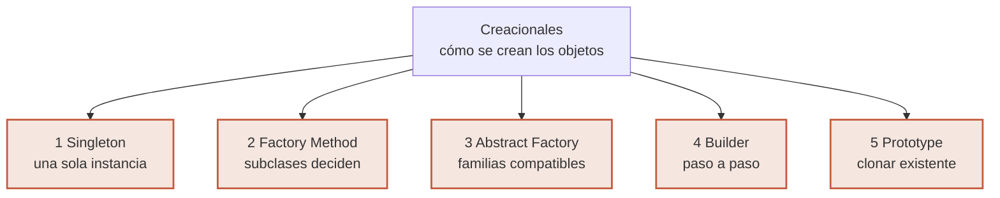
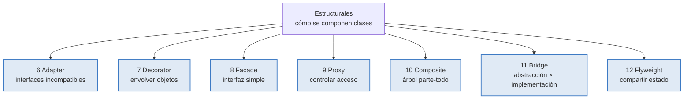
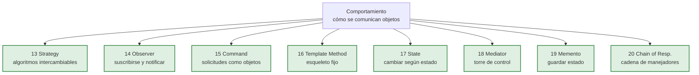

# Patrones de Diseño — Apuntes de estudio

Apuntes rápidos de los 20 patrones GoF implementados en este proyecto.
Para cada patrón: **intención** (qué resuelve), **analogía** (para recordarlo)
y **cuándo usarlo / cuándo NO usarlo**.

## Cómo ejecutar

```bash
dotnet run            # menú interactivo (elige 1-20)
echo 7 | dotnet run   # ejecutar un patrón directamente por número
```

---

## Creacionales (cómo se crean los objetos)

| # | Patrón | Analogía (cultura popular) |
|---|--------|----------|
| 1 | Singleton | El Anillo Único (ESDLA): solo existe uno |
| 2 | Factory Method | Pokémon: cada laboratorio entrega su inicial |
| 3 | Abstract Factory | Casas de Hogwarts: estandarte, mascota y sala a juego |
| 4 | Builder | Forjar un sable de luz (Star Wars) pieza por pieza |
| 5 | Prototype | Los soldados clon de Star Wars |



### 1. Singleton — una sola instancia global

- **Intención:** garantizar que una clase tenga **una única instancia** y un punto de acceso global a ella.
- **Analogía:** el Anillo Único de *El Señor de los Anillos*: "un anillo para gobernarlo todo"; solo existe uno y todos acuden a él.
- **Cuándo usarlo:** configuración global, logger, caché compartida.
- **Cuándo NO usarlo:** cuando necesitas varias instancias en tests (acopla el código y dificulta el testing). En apps reales, la inyección de dependencias suele ser mejor opción.

### 2. Factory Method — creación delegada a subclases

- **Intención:** definir una interfaz para crear objetos, pero dejar que las **subclases decidan qué clase concreta crear**.
- **Analogía:** en Pokémon, cada profesor regional entrega un inicial distinto: el proceso es el mismo, pero cada laboratorio decide cuál crear.
- **Cuándo usarlo:** no sabes de antemano los tipos exactos que crearás; quieres que otros extiendan tu librería sin modificarla.
- **Cuándo NO usarlo:** si solo hay un tipo de producto y no habrá variaciones, un simple `new` es más simple.

### 3. Abstract Factory — familias de objetos compatibles

- **Intención:** crear **familias de objetos relacionados** sin acoplarse a sus clases concretas.
- **Analogía:** cada casa de Hogwarts (Gryffindor, Slytherin...) tiene un set a juego: estandarte, mascota y sala común. La fábrica de una casa produce piezas que siempre combinan.
- **Cuándo usarlo:** familias de objetos que deben usarse juntos (temas de UI, conectores a distintas bases de datos).
- **Cuándo NO usarlo:** si solo hay **un** producto por familia (para eso es Factory Method, más simple).

### 4. Builder — construcción paso a paso

- **Intención:** separar la construcción de un objeto complejo en **pasos encadenables**, evitando constructores gigantes ("constructores telescópicos").
- **Analogía:** forjar un sable de luz de Star Wars pieza por pieza (empuñadura, cristal kyber, color, extras): el mismo proceso arma el sable de un Jedi o de un Sith.
- **Cuándo usarlo:** objetos con muchos parámetros opcionales (consultas SQL, HTTP requests, pedidos).
- **Cuándo NO usarlo:** con 2-3 parámetros simples; el patrón agrega más código que el problema que resuelve.

### 5. Prototype — clonación de objetos

- **Intención:** crear nuevos objetos **copiando un prototipo existente**, en vez de construirlos desde cero.
- **Analogía:** los soldados clon de Star Wars: se producen copiando un prototipo. Un clon superficial comparte equipo; uno profundo es totalmente independiente.
- **Cuándo usarlo:** duplicar recetas/documentos plantilla, crear muchos enemigos similares en un videojuego.
- **Cuidado:** distingue **copia superficial** (comparte referencias: ¡la lista copiada es la misma!) de **copia profunda** (todo nuevo). Este proyecto demuestra ambas.

---

## Estructurales (cómo se componen las clases)

| # | Patrón | Analogía (cultura popular) |
|---|--------|----------|
| 6 | Adapter | Emulador que juega ROMs de consolas retro |
| 7 | Decorator | Encantar un arma de RPG con runas apiladas |
| 8 | Facade | Protocolo Vengadores: una orden, 4 subsistemas |
| 9 | Proxy | Archivos clasificados de S.H.I.E.L.D.: caché + credencial |
| 10 | Composite | Ejércitos de Poniente (GoT): soldado vs legión |
| 11 | Bridge | RPG: armas × elementos mágicos |
| 12 | Flyweight | Ejército de droides (Star Wars): 1000 unidades, 3 modelos |



### 6. Adapter — interfaces incompatibles → compatibles

- **Intención:** hacer que dos interfaces **incompatibles trabajen juntas** traduciendo llamadas.
- **Analogía:** un emulador que juega ROMs de consolas retro (NES, arcade) en una sola máquina: cada Adapter traduce la API antigua a la interfaz común.
- **Cuándo usarlo:** integrar librerías de terceros o sistemas legacy cuya interfaz no puedes cambiar.
- **Cuándo NO usarlo:** si controlas ambas interfaces y puedes cambiarlas, mejor ajustarlas directamente.

### 7. Decorator — añadir funcionalidad dinámicamente

- **Intención:** **envolver** un objeto con otros que le agregan comportamiento, sin herencia ni modificar la clase original.
- **Analogía:** encantar un arma de un RPG (una espada base) con runas de fuego, hielo y rayo: la espada es la misma, cada encantamiento añade poder.
- **Cuándo usarlo:** cuando tendrías una explosión de subclases (pastel con glaseado+chispas+velitas...). Es la base de streams y middleware en .NET.
- **Cuándo NO usarlo:** si solo hay una variante posible, la herencia simple es más directa.

### 8. Facade — interfaz simple para subsistemas complejos

- **Intención:** exponer **una interfaz simple** que orquesta un subsistema complejo.
- **Analogía:** el "Protocolo Vengadores": Nick Fury no ejecuta cada sistema (arsenal, energía, defensa, comunicaciones) por separado; da UNA orden y la fachada coordina todo.
- **Cuándo usarlo:** cuando usar un sistema requiere llamar a varios subsistemas en orden (procesar un pedido: inventario → pago → envío → notificación).
- **Cuándo NO usarlo:** si los clientes siempre necesitan el control fino del subsistema; una fachada innecesaria es una capa más de indirección.

### 9. Proxy — control de acceso a un objeto

- **Intención:** poner un **sustituto** delante del objeto real para controlar el acceso (caché, permisos, lazy loading).
- **Analogía:** los archivos clasificados de S.H.I.E.L.D.: nunca accedes directo a la bóveda; un Proxy de seguridad exige credencial y uno de caché recuerda lo ya consultado.
- **Cuándo usarlo:** cachear llamadas costosas, verificar permisos, lazy loading (Entity Framework lo usa).
- **Cuándo NO usarlo:** si el objeto es barato y no hay reglas de acceso; el proxy solo agrega complejidad.

### 10. Composite — árboles parte-todo

- **Intención:** tratar **objetos individuales y composiciones de objetos de forma uniforme** (estructura de árbol).
- **Analogía:** los ejércitos de Poniente (Game of Thrones): un soldado suelto y una legión completa responden la misma pregunta ("¿cuántos hombres?").
- **Cuándo usarlo:** sistemas de archivos, menús, orgánigramas, árboles de componentes UI.
- **Cuándo NO usarlo:** si la estructura nunca es anidada (solo hay hojas), el árbol es innecesario.

### 11. Bridge — abstracción e implementación independientes

- **Intención:** separar una **abstracción** de su **implementación** para que ambas dimensiones (ej. receta / método de cocción) evolucionen sin multiplicarse.
- **Analogía:** en un RPG combinas un arma (espada, arco, bastón) con un elemento mágico (fuego, hielo, rayo): dos perillas independientes, sin una clase por combinación.
- **Cuándo usarlo:** cuando tienes dos dimensiones de variación (sin Bridge: 3 armas × 3 elementos = 9 clases; con Bridge: 3 + 3 = 6).
- **Cuándo NO usarlo:** con una sola dimensión, herencia simple basta.

### 12. Flyweight — compartir objetos en gran cantidad

- **Intención:** compartir el estado **intrínseco** (común) entre miles de objetos, dejando lo **extrínseco** (posición) en el cliente.
- **Analogía:** el ejército de droides de Star Wars: miles de unidades, pero todas del mismo modelo comparten diseño en memoria; solo cambia su posición.
- **Cuándo usarlo:** muchísimos objetos similares en memoria (tiles de videojuegos, caracteres de un documento).
- **Cuándo NO usarlo:** con pocos objetos o cuando no hay nada compartible; la factory complica sin beneficio.

---

## Comportamiento (cómo se comunican los objetos)

| # | Patrón | Analogía (cultura popular) |
|---|--------|----------|
| 13 | Strategy | Ryu cambia su estilo de pelea según el rival |
| 14 | Observer | La Batiseñal (DC): todos los aliados reaccionan |
| 15 | Command | Rewind de videojuego: rebobinar cada acción |
| 16 | Template Method | El Viaje del Héroe: Luke y Frodo, mismo monomito |
| 17 | State | Evolución Pokémon: Charmander → Charizard |
| 18 | Mediator | Party de raid (WoW): todos hablan por el chat |
| 19 | Memento | El Pensadero (Harry Potter): revivir recuerdos |
| 20 | Chain of Responsibility | Escalada de amenazas: Guardián → Héroe → Liga |



### 13. Strategy — algoritmos intercambiables

- **Intención:** encapsular **familias de algoritmos** intercambiables en tiempo de ejecución.
- **Analogía:** en un juego de pelea (o RPG) eliges el estilo de combate de tu luchador: agresivo, defensivo o equilibrado. El personaje es el mismo; solo cambia la estrategia.
- **Cuándo usarlo:** varios "motores" intercambiables (impuestos por país, métodos de pago, compresión).
- **Cuándo NO usarlo:** si el algoritmo nunca cambia, inyectarlo es complejidad gratis.

### 14. Observer — suscripción uno-a-muchos

- **Intención:** cuando un objeto cambia, **todos sus suscriptores se notifican** automáticamente.
- **Analogía:** la Batiseñal de Gotham: cuando Gordon la enciende, todos los aliados (Robin, Alfred, la Liga) reaccionan sin que Batman los llame uno por uno.
- **Cuándo usarlo:** eventos de UI, notificaciones push, sincronizar vistas.
- **Cuándo NO usarlo:** si un solo receptor escucha siempre, un callback directo es más simple. Cuidado con el orden de desuscripción (memory leaks).

### 15. Command — solicitudes como objetos

- **Intención:** encapsular una solicitud como objeto: se puede **parametrizar, encolar y deshacer** (undo/redo).
- **Analogía:** un videojuego tipo "rewind" (Prince of Persia, Braid): cada acción del personaje (saltar, mover) es un comando que puede ejecutarse y deshacerse (rebobinar el tiempo).
- **Cuándo usarlo:** undo/redo (Ctrl+Z), colas de trabajos, macros, logging de acciones.
- **Cuándo NO usarlo:** si la operación nunca se deshace, encola ni parametriza, una llamada directa es más simple.

### 16. Template Method — esqueleto de algoritmo

- **Intención:** definir la **estructura fija** del algoritmo en la clase base; las subclases rellenan pasos concretos.
- **Analogía:** el "Viaje del Héroe" (monomito de Campbell) que siguen Luke Skywalker, Frodo o Simba: los pasos son fijos (llamado → pruebas → retorno), pero cada héroe los vive a su manera.
- **Cuándo usarlo:** pipelines con pasos comunes que varían en el detalle (procesar CSV/JSON, generar reportes).
- **Cuándo NO usarlo:** si cada implementación difiere mucho en el flujo, mejor composición (Strategy).

### 17. State — comportamiento según el estado

- **Intención:** un objeto **cambia de comportamiento según su estado interno**; cada estado es una clase.
- **Analogía:** la evolución de un Pokémon (Charmander → Charmeleon → Charizard): el mismo "ser" cambia de comportamiento y ataques según su estado evolutivo.
- **Cuándo usarlo:** flujos de pedidos, máquinas de estados de videojuegos, workflows de aprobación.
- **Cuándo NO usarlo:** con 2 estados triviales, un `enum` + `switch` es más simple y suficiente.

### 18. Mediator — comunicación centralizada

- **Intención:** evitar que N objetos se referencien entre sí; **todos se comunican a través de un mediador**.
- **Analogía:** la party de un MMO (World of Warcraft): el tanque, el sanador y el DPS no se hablan entre sí; todo se coordina por el chat del grupo (el mediador).
- **Cuándo usarlo:** salas de chat, paneles UI que se afectan entre sí, coordinación de formularios.
- **Cuándo NO usarlo:** si solo dos objetos se comunican, el mediador es un intermediario innecesario.

### 19. Memento — guardar/restaurar estado

- **Intención:** capturar el estado interno de un objeto **sin violar su encapsulamiento** para restaurarlo después.
- **Analogía:** el Pensadero de Harry Potter: Dumbledore extrae un recuerdo, lo guarda en un frasco y puede volver a sumergirse en él exactamente como era.
- **Cuándo usarlo:** checkpoints, undo de estado completo, snapshots.
- **Cuándo NO usarlo:** si el objeto es pequeño, guardar una copia simple basta; el patrón brilla con estado grande o privado.

### 20. Chain of Responsibility — cadena de manejadores

- **Intención:** pasar una solicitud por una **cadena de manejadores**; cada uno la procesa o la pasa al siguiente.
- **Analogía:** la escalada de una amenaza entre superhéroes (Liga de la Justicia): el guardián local intenta manejarla; si no puede, escala a un superhéroe, luego al equipo y por último a la Liga completa.
- **Cuándo usarlo:** middleware, validaciones encadenadas, escalado de aprobaciones.
- **Cuándo NO usarlo:** si siempre sabes quién maneja la solicitud, un `switch` o llamada directa es más claro.

---

## Patrones GoF no incluidos (a propósito)

- **Interpreter** — raro en la práctica; en C# se cubre con expression trees / parsers.
- **Iterator** — C# ya lo trae de fábrica: `IEnumerable<T>`, `foreach`, LINQ.
- **Visitor** — especializado en árboles de sintaxis; poco útil en un proyecto introductorio.

## Material relacionado

- `notebooklm-patrones-diseno.md` — guía extendida por patrón (definición, participantes, comparativas, ejercicios), optimizada para NotebookLM.
- `README.md` — cómo ejecutar el proyecto.
