# Guía Completa de Patrones de Diseño GoF — Material para NotebookLM

<!--
title: Guía de Patrones GoF - C# 14 / .NET 10
author: Chienwei82
updated: 2026-11-23
version: 2.3
patterns: 20 de 23 GoF
language: es
-->

> Este documento resume los 23 patrones clásicos del libro *Design Patterns: Elements of Reusable Object-Oriented Software* (Gang of Four); 20 de ellos están implementados en este proyecto con C# 14/.NET 10. Está optimizado para ingestión por herramientas de IA como NotebookLM.

---

## 1. Introducción: ¿Qué son los Patrones de Diseño?

Los patrones de diseño son **soluciones probadas y reutilizables** a problemas comunes en el diseño de software orientado a objetos. No son librerías ni código copy-paste, sino **plantillas conceptuales** que guían la estructura de clases y objetos.

Fueron catalogados por **Erich Gamma, Richard Helm, Ralph Johnson y John Vlissides** ("Gang of Four" o GoF) en 1994. Se dividen en tres familias según su propósito:

| Familia | Propósito | Patrones incluidos |
|---------|-----------|-------------------|
| **Creacionales** | Cómo se crean los objetos | Singleton, Factory Method, Abstract Factory, Builder, Prototype |
| **Estructurales** | Cómo se componen las clases y objetos | Adapter, Decorator, Facade, Proxy, Composite, Bridge, Flyweight |
| **De Comportamiento** | Cómo se comunican y distribuyen responsabilidades | Strategy, Observer, Command, Template Method, State, Mediator, Memento, Chain of Responsibility |

```mermaid
graph TB
    classDef creacional fill:#f5e6e0,stroke:#c45a3d,stroke-width:2px;
    classDef estructural fill:#e0eaf5,stroke:#3d7ac4,stroke-width:2px;
    classDef comportamiento fill:#dff0e2,stroke:#3d8b4a,stroke-width:2px;

    GOF[Patrones GoF<br/>Gang of Four, 1994]

    GOF --> C[Creacionales<br/>5 patrones]
    GOF --> E[Estructurales<br/>7 patrones]
    GOF --> B[Comportamiento<br/>8 patrones]

    C --> S1[Singleton]
    C --> S2[Factory Method]
    C --> S3[Abstract Factory]
    C --> S4[Builder]
    C --> S5[Prototype]

    E --> S6[Adapter]
    E --> S7[Decorator]
    E --> S8[Facade]
    E --> S9[Proxy]
    E --> S10[Composite]
    E --> S11[Bridge]
    E --> S12[Flyweight]

    B --> S13[Strategy]
    B --> S14[Observer]
    B --> S15[Command]
    B --> S16[Template Method]
    B --> S17[State]
    B --> S18[Mediator]
    B --> S19[Memento]
    B --> S20[Chain of Resp.]

    class S1,S2,S3,S4,S5 creacional;
    class S6,S7,S8,S9,S10,S11,S12 estructural;
    class S13,S14,S15,S16,S17,S18,S19,S20 comportamiento;
```

**Nota importante:** Este proyecto contiene implementaciones educativas de **20 de los 23 patrones GoF**. Faltan intencionalmente: Interpreter, Iterator y Visitor (más especializados o ya cubiertos por el lenguaje C#).

---

## 2. Claves para entender cualquier patrón

Antes de estudiar cada uno, estos son los conceptos transversales que aparecen en casi todos:

- **Composición sobre herencia:** Muchos patrones prefieren "tener un objeto" (composición) en vez de "ser un objeto" (herencia).
- **Programar contra interfaces, no contra implementaciones:** Depender de abstracciones (`interface`, `abstract class`) en lugar de clases concretas.
- **Principio de responsabilidad única (SRP):** Cada clase debe tener una sola razón para cambiar.
- **Principio abierto/cerrado (OCP):** Abierto a extensión, cerrado a modificación.

---

## 3. Patrones Creacionales (Cómo nacen los objetos)

### 3.1 Singleton

**Definición:** Garantiza que una clase tenga **una única instancia** en toda la aplicación y provee un punto de acceso global a ella.

**Propósito:** Controlar el acceso a recursos compartidos (configuración, conexiones a BD, logger, caché).

**Cuándo usarlo:**
- Necesitas exactamente un objeto coordinando acciones en todo el sistema.
- El costo de crear el objeto es alto y se usa frecuentemente.

**Participantes:**
- `Singleton`: la clase con constructor privado y método de acceso estático.

**Flujo típico:**
1. La primera vez que se solicita la instancia, se crea.
2. Las siguientes veces, se devuelve la misma referencia.
3. En .NET moderno, `Lazy<T>` garantiza thread-safety sin locks explícitos.

**Analogía:** El Anillo Único de *El Señor de los Anillos*. Solo puede existir uno en toda la Tierra Media, y todos los personajes (objetos) que quieren usarlo acuden a esa misma figura.

**Ejemplo real del proyecto:** Una clase `AnilloUnico` (el Anillo Único de *El Señor de los Anillos*) que representa el "único anillo para gobernarlo todo". Usar `Lazy<T>` asegura que, aunque Frodo y Gandalf lo soliciten a la vez, solo se forja una vez y comparten su estado (portador, invisibilidad).

**Relaciones:** A menudo se usa con **Factory Method** (la factory puede ser Singleton) o **Abstract Factory**.

---

### 3.2 Factory Method

**Definición:** Define una interfaz para crear objetos, pero **delega a las subclases** la decisión de qué clase concreta instanciar.

**Propósito:** Desacoplar el código cliente del proceso de creación. El cliente depende de una abstracción, no de una clase concreta.

**Cuándo usarlo:**
- No sabes de antemano los tipos exactos de objetos que creará tu código.
- Quieres que los usuarios de tu librería extiendan los tipos sin modificar tu código.

**Participantes:**
- `Product`: interfaz común de los objetos creados.
- `ConcreteProduct`: implementaciones específicas.
- `Creator`: clase abstracta con el Factory Method declarado.
- `ConcreteCreator`: subclases que deciden qué `ConcreteProduct` crear.

**Flujo típico:**
1. El cliente crea un `ConcreteCreator`.
2. Llama a un método de la clase `Creator` que internamente invoca `FactoryMethod()`.
3. El `ConcreteCreator` devuelve su `ConcreteProduct` correspondiente.

**Analogía:** En Pokémon, el proceso de "recibir el inicial" es siempre el mismo, pero cada laboratorio/profesor regional (Oak en Kanto, Elm en Johto) decide qué Pokémon concreto entregar.

**Ejemplo real del proyecto:** Pokémon. `LaboratorioPokemon` es la clase abstracta y existen `LaboratorioKanto`, `LaboratorioJohto` y `LaboratorioHoenn`. Cada laboratorio decide qué Pokémon inicial crear (`Bulbasaur`, `Cyndaquil` o `Mudkip`) antes de entregarlo al entrenador.

**Relaciones:** Se combina frecuentemente con **Singleton** (la factory puede ser única) o con **Strategy** (los productos creados suelen ser estrategias intercambiables).

---

### 3.3 Abstract Factory

**Definición:** Proporciona una interfaz para crear **familias de objetos relacionados** sin especificar sus clases concretas.

**Propósito:** Asegurar que los productos creados sean compatibles entre sí. Si pides una entrada italiana, el plato fuerte también debe ser italiano.

**Cuándo usarlo:**
- Tu sistema debe ser independiente de cómo se crean, componen y representan sus productos.
- Necesitas garantizar que los objetos de una familia se usen juntos (temas UI, drivers de BD, toolkit multiplataforma).

**Participantes:**
- `AbstractFactory`: declara métodos para crear cada producto abstracto.
- `ConcreteFactory`: implementa esos métodos para una familia específica.
- `AbstractProduct`: interfaces de cada tipo de producto.
- `ConcreteProduct`: implementaciones de una familia.

**Flujo típico:**
1. El cliente recibe una `AbstractFactory` (no sabe cuál concreta).
2. Pide un `Boton` y una `Ventana`.
3. La factory concreta devuelve siempre productos del mismo tema/familia.

**Analogía:** Las casas de Hogwarts. Cada casa tiene un set a juego —estandarte, mascota, sala común, colores—; el de Gryffindor siempre es rojo y dorado con un león, el de Slytherin verde y plateado con una serpiente. Nunca mezclas piezas de dos casas.

**Ejemplo real del proyecto:** Las casas de Hogwarts. `ICasaHogwartsFactory` con métodos `CrearEstandarte()`, `CrearMascota()` y `CrearSalaComun()`. Las implementaciones `GryffindorFactory` (EstandarteGryffindor + MascotaGryffindor + SalaGryffindor) y `SlytherinFactory` (EstandarteSlytherin + MascotaSlytherin + SalaSlytherin) garantizan que las piezas de cada casa siempre combinen entre sí.

**Relaciones:** Abstract Factory suele implementarse con **Factory Methods** (cada método de la factory es un factory method). A menudo la Abstract Factory misma es un **Singleton**.

---

### 3.4 Builder

**Definición:** Separa la construcción de un objeto complejo de su representación, permitiendo que el **mismo proceso de construcción** cree **diferentes representaciones**.

**Propósito:** Evitar constructores con 10+ parámetros. Construir objetos paso a paso, opcionalmente, con una sintaxis legible.

**Cuándo usarlo:**
- El algoritmo para crear un objeto debe ser independiente de las partes que lo componen.
- El proceso de construcción debe permitir distintas representaciones del objeto final.

**Participantes:**
- `Builder`: interfaz abstracta con pasos de construcción.
- `ConcreteBuilder`: implementa los pasos y expone el producto final.
- `Director` (opcional): orquesta el orden de los pasos para recetas comunes.
- `Product`: el objeto complejo resultante.

**Flujo típico:**
1. Creas un `ConcreteBuilder`.
2. Opcionalmente, pasas un `Director` con una receta predefinida (ej. "la monstruosa").
3. El director llama a los pasos en orden: `ConPan()`, `ConCarne()`, `AgregarExtra()`, etc.
4. Finalmente se llama `Construir()` para obtener el producto terminado.

**Analogía:** Forjar un sable de luz de Star Wars. El cliente puede pedirlo pieza por pieza: empuñadura, cristal kyber, color de hoja, extras. O puede pedir "un sable Jedi" que el Director (Artífice) sabe cómo armar.

**Ejemplo real del proyecto:** Un sable de luz de Star Wars. `SableBuilder` construye un `SableDeLuz` paso a paso (ConEmpunadura, ConCristal, ConColor, DobleFilo, ConDescargaElectrica). `ArtificeDirector` tiene sables predefinidos como `SableJedi()`, `SableSith()` y `SableDobleFilo()`. Tras `Build()`, el builder se resetea automáticamente para poder reutilizarse.

**Relaciones:** A menudo se usa junto a **Composite** (el producto final es una estructura compuesta) o **Bridge** (el producto puede usar diferentes implementaciones).

---

### 3.5 Prototype

**Definición:** Permite copiar objetos existentes sin que el código dependa de sus clases concretas. El objeto original sirve como "prototipo".

**Propósito:** Crear nuevos objetos clonando uno existente, especialmente cuando la inicialización es costosa o compleja.

**Cuándo usarlo:**
- Crear un objeto desde cero es más costoso que copiar uno existente.
- Necesitas objetos similares pero con pequeñas variaciones.
- Quieres evitar la complejidad de subclases solo para variar estados.

**Participantes:**
- `Prototype`: interfaz con método `Clone()`.
- `ConcretePrototype`: implementa la clonación (shallow o deep).
- `Client`: solicita la clonación.

**Flujo típico:**
1. Creas un objeto base (prototipo) y lo configuras.
2. Cuando necesitas uno similar, llamas `Clone()` en vez de `new`.
3. Ajustas las propiedades que difieren.

**Analogía:** Los soldados clon de Star Wars. En vez de criar cada clon desde cero, Kamino copia al prototipo original; con un clon superficial el equipo se comparte, con uno profundo cada soldado queda totalmente independiente.

**Ejemplo real del proyecto:** Los soldados clon de Star Wars. `SoldadoClon` implementa `ICloneable`. Se demuestra la diferencia entre `Clone()` (shallow copy, comparte la `List<string>` de equipo y el `RegistroAD`) y `DeepClone()` (copia profunda, todo es independiente). `RegistroAD` se implementó como un `record` inmutable.

**Relaciones:** El **Prototype** puede usarse para inicializar **Singletons** o puede ser creado por una **Factory**.

---

## 4. Patrones Estructurales (Cómo se componen las clases)

### 4.1 Adapter

**Definición:** Permite que clases con interfaces **incompatibles** trabajen juntas. Actúa como traductor.

**Propósito:** Integrar código legacy, APIs de terceros o bibliotecas cuyas interfaces no coinciden con las que espera tu sistema.

**Cuándo usarlo:**
- Quieres usar una clase existente pero su interfaz no coincide con la que necesitas.
- Necesitas crear una clase reutilizable que coopere con clases no previstas.

**Participantes:**
- `Target`: la interfaz que el cliente espera.
- `Adaptee`: la clase existente con interfaz incompatible.
- `Adapter`: implementa `Target` y traduce llamadas hacia `Adaptee`.

**Flujo típico:**
1. El cliente trabaja con `Target`.
2. El `Adapter` implementa `Target`.
3. Internamente, el `Adapter` convierte los datos y llama a `Adaptee`.

**Analogía:** Un emulador que juega ROMs de consolas retro. El emulador solo conoce una interfaz común (`Jugar`); cada consola clásica (NES, arcade) tiene su propia API, y un Adapter la traduce.

**Ejemplo real del proyecto:** Un emulador retro. `IConsolaRetro` es la interfaz esperada (`Jugar(rom)`). Existen dos `Adaptees`: `ConsolaNES` (métodos `Encender()` + `InsertarCartucho()`) y `ArcadeOriginal` (`EsperarAttractMode()` + `InsertarMonedas()`). `ConsolaNesAdapter` y `ArcadeAdapter` traducen las llamadas a la interfaz común.

**Relaciones:** El **Adapter** puede adaptar no solo una clase, sino todo un subsistema (convirtiéndose en un tipo de **Facade**). También se parece al **Proxy**, pero el Adapter cambia la interfaz; el Proxy mantiene la misma interfaz.

---

### 4.2 Decorator

**Definición:** Permite añadir comportamientos a objetos de forma **dinámica**, envolviéndolos en objetos decorador.

**Propósito:** Extender funcionalidad sin herencia. Combinar comportamientos en tiempo de ejecución.

**Cuándo usarlo:**
- Necesitas agregar responsabilidades a objetos de forma dinámica y transparente.
- La extensión por subclases sería impracticable (explosión combinatoria de clases).

**Participantes:**
- `Component`: interfaz común.
- `ConcreteComponent`: el objeto base.
- `Decorator`: clase abstracta que delega al componente.
- `ConcreteDecorator`: añade comportamiento específico.

**Flujo típico:**
1. Creas un `ConcreteComponent`.
2. Lo envuelves en un `ConcreteDecorator`.
3. Ese resultado lo envuelves en otro `ConcreteDecorator`.
4. Cada capa añade su funcionalidad antes/después de delegar al interior.

**Analogía:** Encantar un arma de un RPG. La espada base es el componente. Le agregas una runa de fuego (decorador), luego una de hielo, luego una de rayo. Puedes apilar, quitar o cambiar cualquier encantamiento sin tocar la espada.

**Ejemplo real del proyecto:** Encantar un arma de RPG. `IArma` es el componente. `EspadaBasica` es la base (10 de daño). `EncantamientoFuego`, `EncantamientoHielo` y `EncantamientoRayo` son decoradores que suman daño y efecto. Un arma puede ser `new EncantamientoRayo(new EncantamientoHielo(new EncantamientoFuego(new EspadaBasica())))`.

**Relaciones:** El **Decorator** tiene la misma estructura de objetos que **Composite** (árbol), pero el Decorator solo tiene un hijo. También se asemeja al **Proxy** (ambos envuelven objetos), pero el Proxy controla acceso, mientras el Decorator añade responsabilidades.

---

### 4.3 Facade

**Definición:** Proporciona una **interfaz simplificada** para un subsistema complejo.

**Propósito:** Reducir la curva de aprendizaje y el acoplamiento al ocultar la complejidad interna de múltiples subsistemas.

**Cuándo usarlo:**
- Necesitas proporcionar una interfaz simple para un subsistema complejo.
- Hay muchas dependencias entre clientes y clases de implementación.
- Quieres desacoplar los subsistemas de los clientes.

**Participantes:**
- `Facade`: la clase que expone la interfaz simple.
- `Subsystem classes`: las clases complejas que la Facade coordina.

**Flujo típico:**
1. El cliente llama un solo método de la `Facade`.
2. La `Facade` coordina múltiples llamadas internas a los subsistemas.
3. El cliente nunca interactúa directamente con los subsistemas.

**Analogía:** El "Protocolo Vengadores". Nick Fury (cliente) solo da una orden; el centro de mando (Facade) coordina arsenal, energía, defensa y comunicaciones por él, sin que Fury hable con cada subsistema.

**Ejemplo real del proyecto:** `CentroDeMando` (el "Protocolo Vengadores") orquesta 4 subsistemas: `Arsenal`, `Repulsores`, `EscudoDefensor` y `Comunicaciones`. El cliente (Nick Fury) llama `ActivarProtocolo()` y la Facade maneja el flujo completo, devolviendo el id de barrera o `null` si algo falla. Además incluye un constructor con inyección de dependencias para testear con mocks.

**Relaciones:** Una **Facade** puede usar internamente **Factory Methods** para crear objetos del subsistema. Puede interactuar con **Singletons** (si los subsistemas son únicos). No transforma la interfaz como el **Adapter**, solo la simplifica.

---

### 4.4 Proxy

**Definición:** Proporciona un sustituto o representante de otro objeto para **controlar el acceso** a él.

**Propósito:** Interponerse entre el cliente y el objeto real para agregar lógica: lazy loading, control de acceso, logging, caché, o llamadas remotas.

**Cuándo usarlo:**
- El objeto es costoso de crear y quieres posponer su creación.
- Necesitas controlar acceso según permisos (seguridad).
- Quieres agregar logging o caché sin modificar el objeto real.

**Participantes:**
- `Subject`: interfaz común.
- `RealSubject`: el objeto costoso o sensible.
- `Proxy`: implementa `Subject`, intercepta llamadas y delega a `RealSubject`.

**Flujo típico:**
1. El cliente trabaja con `Subject`.
2. El `Proxy` intercepta la llamada.
3. El `Proxy` decide: devolver caché, rechazar por permisos, o delegar al `RealSubject`.

**Analogía:** Los archivos clasificados de S.H.I.E.L.D. Tú (cliente) no entras directo a la bóveda (objeto real): un Proxy de seguridad revisa tu credencial y uno de caché recuerda los expedientes ya consultados.

**Ejemplo real del proyecto:** Los archivos clasificados de S.H.I.E.L.D. Se implementan dos proxies sobre `IRepositorioClasificado`:
- `ExpedienteCacheProxy`: recuerda expedientes ya consultados, así que la segunda consulta del mismo id es instantánea.
- `ExpedienteSeguridadProxy`: verifica la credencial (solo `director` accede a ids `nivel-10`). Muestra tanto el caso denegado (`agente`) como el permitido (`director`).

**Relaciones:** El **Proxy** tiene la misma interfaz que el objeto real, a diferencia del **Adapter**. Un **Proxy** de caché se parece al **Flyweight** (ambos evitan crear objetos), pero el Proxy controla un único objeto real, mientras el Flyweight comparte muchos objetos pequeños.

---

### 4.5 Composite

**Definición:** Permite tratar objetos **individuales y composiciones** de objetos de manera uniforme. Organiza objetos en estructuras de árbol (parte-todo).

**Propósito:** Representar jerarquías parte-todo donde el cliente no necesita distinguir entre hojas y compuestos.

**Cuándo usarlo:**
- Quieres representar una jerarquía de objetos tipo árbol.
- Quieres que el cliente ignore la diferencia entre composiciones de objetos y objetos individuales.

**Participantes:**
- `Component`: interfaz común para hojas y compuestos.
- `Leaf`: objeto individual sin hijos.
- `Composite`: objeto que contiene hijos (otros Components).

**Flujo típico:**
1. El cliente trabaja con `Component`.
2. Puede llamar `Operacion()` tanto en una hoja como en un compuesto.
3. El `Composite` delega la operación a todos sus hijos y agrega los resultados.

**Analogía:** Los ejércitos de Poniente (Game of Thrones). Un soldado suelto (hoja) y una legión completa (composite) responden la misma pregunta ("¿cuántos hombres?"): simplemente sumas todo, sin importar si es un soldado o una legión entera.

**Ejemplo real del proyecto:** Los ejércitos de Poniente (Game of Thrones). `IUnidad` con `Soldado` (hoja) y `Legion` (composite). El composite usa LINQ (`Sum`) para contar soldados. El cliente llama `Formar()` o `ContarSoldados()` sin saber si es soldado o legión, y una legión puede contener otras legiones.

**Relaciones:** El **Composite** es estructuralmente similar al **Decorator** (ambos usan composición recursiva), pero el Composite modela jerarquías parte-todo, mientras el Decorator añade responsabilidades. Frecuentemente se usa junto al **Iterator** para recorrer la estructura.

---

### 4.6 Bridge

**Definición:** Separa una **abstracción** de su **implementación**, permitiendo que ambas evolucionen independientemente.

**Propósito:** Evitar la "explosión de subclases" cuando tienes múltiples dimensiones de variación. Ejemplo: si tienes 3 formas y 3 colores, sin Bridge necesitas 9 clases; con Bridge, 3 + 3 = 6.

**Cuándo usarlo:**
- Quieres evitar un vínculo permanente entre una abstracción y su implementación.
- Tanto la abstracción como la implementación deben poder extenderse por subclases.
- Quieres ocultar la implementación completamente a los clientes.

**Participantes:**
- `Abstraction`: define la interfaz del cliente, mantiene referencia a `Implementor`.
- `RefinedAbstraction`: extiende la abstracción.
- `Implementor`: interfaz de la implementación.
- `ConcreteImplementor`: implementaciones concretas.

**Flujo típico:**
1. El cliente crea una `Abstraction` pasándole un `Implementor`.
2. Llama a métodos de la abstracción.
3. La abstracción delega las operaciones de bajo nivel al `Implementor`.

**Analogía:** Un RPG donde combinas un arma (abstracción) con un elemento mágico (implementación). Agregar un elemento nuevo (rayo) no requiere cambiar las armas; agregar un arma nueva no requiere cambiar los elementos.

**Ejemplo real del proyecto:** Un RPG de armas y elementos. `ArmaElemental` es la abstracción con subclases `Arco`, `Baston` y `EspadaElemental`. `IElementoMagico` es el implementor con `Fuego`, `Hielo` y `Rayo`. Un `Arco` puede combinar con cualquier elemento (2 dimensiones independientes: 3 + 3 = 6 clases, no 3 × 3 = 9).

**Relaciones:** El **Bridge** es similar al **Adapter**, pero el Bridge desacopla desde el diseño (pre-planificado), mientras el Adapter corrige incompatibilidades existentes (post-hoc). A menudo el producto de un **Builder** usa un **Bridge** para ser independiente de su implementación.

---

### 4.7 Flyweight

**Definición:** Comparte eficientemente objetos que se usan en gran cantidad. Divide el estado en **intrínseco** (compartido) y **extrínseco** (proporcionado por el contexto).

**Propósito:** Reducir el uso de memoria cuando un programa contiene una enorme cantidad de objetos similares.

**Cuándo usarlo:**
- Tu aplicación usa una gran cantidad de objetos.
- Los costos de almacenamiento son altos por la cantidad de objetos.
- La mayoría del estado de los objetos puede volverse extrínseco.

**Participantes:**
- `Flyweight`: la clase con estado intrínseco compartido.
- `FlyweightFactory`: crea y administra los flyweights, asegurando que se compartan.
- `Client`: mantiene el estado extrínseco y lo pasa al flyweight cuando opera.

**Flujo típico:**
1. El cliente pide un objeto al `FlyweightFactory`.
2. Si ya existe uno con esas características intrínsecas, se reutiliza.
3. Si no, se crea y se registra.
4. El cliente pasa el estado extrínseco (posición, contexto) en cada llamada.

**Analogía:** El ejército de droides de Star Wars. En vez de crear 1,000 objetos "Droide" con su propio modelo, cada droide solo guarda su posición (extrínseco). El modelo, el color y el diseño son compartidos (intrínsecos) por todas las unidades.

**Ejemplo real del proyecto:** El ejército de droides de Star Wars. `ModeloDroide` es el flyweight con tipo y color (intrínseco). `Droide` es el contexto con la posición `(x, y)` (extrínseco). `FabricaDroides` administra los modelos. Al desplegar 1,000 droides solo se crean 3 instancias de `ModeloDroide` en memoria.

**Relaciones:** El **Flyweight** se parece al **Singleton** (ambos controlan instancias), pero el Flyweight maneja múltiples instancias compartidas por clave. A menudo se usa dentro de **Composite** (las hojas pueden ser flyweights).

---

## 5. Patrones de Comportamiento (Cómo se comunican los objetos)

### 5.1 Strategy

**Definición:** Define una familia de algoritmos, los encapsula y los hace **intercambiables**. Permite que el algoritmo varíe independientemente del cliente.

**Propósito:** Eliminar condicionales largos (`if/else` o `switch`) al encapsular cada algoritmo en su propia clase.

**Cuándo usarlo:**
- Tienes muchas clases relacionadas que difieren solo en su comportamiento.
- Necesitas diferentes variantes de un algoritmo.
- Un algoritmo usa datos que el cliente no debería conocer.

**Participantes:**
- `Strategy`: interfaz común de todos los algoritmos.
- `ConcreteStrategy`: implementaciones específicas.
- `Context`: mantiene una referencia a una estrategia y la ejecuta.

**Flujo típico:**
1. El `Context` recibe una estrategia concreta.
2. El cliente solicita una operación al `Context`.
3. El `Context` delega el cálculo a la estrategia.
4. En tiempo de ejecución, se puede cambiar la estrategia.

**Analogía:** Los estilos de un luchador de fighting game (como Ryu). El rival es el mismo contexto, pero puedes elegir pelear agresivo, a la defensiva o equilibrado. El mapa (personaje) cambia de estilo según la estrategia seleccionada.

**Ejemplo real del proyecto:** Los estilos de combate de un fighting game. `IEstiloCombate` es la estrategia con implementaciones `EstiloAgresivo`, `EstiloDefensivo` y `EstiloEquilibrado`. `Luchador` (Ryu) es el contexto que permite cambiar de estilo en tiempo de ejecución con `CambiarEstilo()` según el rival.

**Relaciones:** El **Strategy** es similar al **State** (ambos usan composición para cambiar comportamiento), pero el Strategy cambia algoritmos por decisión del cliente, mientras el State cambia automáticamente según el estado interno. A menudo los objetos creados por **Factory Method** son estrategias.

---

### 5.2 Observer

**Definición:** Define una dependencia **uno-a-muchos** entre objetos, de modo que cuando uno cambia de estado, todos sus dependientes son notificados automáticamente.

**Propósito:** Desacoplar el emisor de los receptores. Un sujeto puede tener cualquier número de observadores que reaccionan a eventos sin que el sujeto los conozca directamente.

**Cuándo usarlo:**
- Un cambio en un objeto requiere cambiar otros, pero no sabes de antemano cuántos ni cuáles.
- Un objeto debe notificar a otros sin hacer suposiciones sobre quiénes son.

**Participantes:**
- `Subject`: mantiene la lista de observadores y los notifica.
- `Observer`: interfaz con método de actualización.
- `ConcreteObserver`: implementa la reacción a la notificación.

**Flujo típico:**
1. Los observadores se suscriben al `Subject`.
2. El `Subject` cambia de estado.
3. El `Subject` recorre su lista y llama `Notificar()` en cada observador.
4. Cada observador reacciona según su lógica.

**Analogía:** La Batiseñal de Gotham. Cuando Gordon la enciende (cambio de estado), todos los aliados (Robin, Alfred, la Liga) se notifican simultáneamente. La Batiseñal no sabe cuántos aliados tiene ni cómo reaccionan.

**Ejemplo real del proyecto:** La Batiseñal (DC). `BatSenal` es el sujeto. Existen `Robin`, `Alfred`, `ComisionadoGordon` y `VigilanteDelJoker` (que solo reacciona a amenazas del Joker). Cuando Gordon enciende la Batiseñal, `EncenderSenal()` notifica a todos los suscriptores registrados.

**Relaciones:** El **Observer** es la base del patrón **MVC** (Modelo notifica a las Vistas). En C#, los `events` y `delegates` son implementaciones nativas del patrón Observer. Frecuentemente se usa con **Mediator** (el mediator puede actuar como subject centralizado).

---

### 5.3 Command

**Definición:** Encapsula una solicitud como un **objeto**, permitiendo parametrizar clientes con diferentes solicitudes, encolar operaciones y soportar operaciones reversibles (UNDO/REDO).

**Propósito:** Desacoplar el objeto que invoca una operación del objeto que la ejecuta. Convertir acciones en objetos manipulables.

**Cuándo usarlo:**
- Quieres parametrizar objetos con una acción a ejecutar.
- Necesitas encolar, ejecutar o programar operaciones.
- Necesitas soportar deshacer (undo).

**Participantes:**
- `Command`: interfaz con `Ejecutar()` y `Deshacer()`.
- `ConcreteCommand`: vincula un Receiver con una acción.
- `Receiver`: el objeto que sabe cómo realizar la operación.
- `Invoker`: solicita el comando y mantiene el historial.

**Flujo típico:**
1. El cliente crea un `ConcreteCommand` y le pasa el `Receiver`.
2. El `Invoker` recibe el comando.
3. El `Invoker` llama `Ejecutar()`.
4. El comando delega al `Receiver`.
5. Para deshacer, el `Invoker` llama `Deshacer()` usando el historial.

**Analogía:** Un videojuego con "rewind" (Prince of Persia, Braid). Cada acción (saltar, mover) es un comando. El botón de mover no sabe cómo funciona el motor del juego; solo envía la orden, y "rebobinar" puede revertir la última acción.

**Ejemplo real del proyecto:** Un videojuego con "rewind". `Personaje` es el receiver. Existen `MoverComando` y `SaltarComando`. `ControlDeJuego` es el invoker con dos stacks: uno para `UNDO` y otro para `REDO`. Cada comando guarda estado suficiente para poder rebobinar la acción.

**Relaciones:** El **Command** se combina con **Memento** para guardar el estado necesario para deshacer. También se usa con **Composite** para crear macros (comandos compuestos). El **Chain of Responsibility** puede usarse para encadenar comandos.

---

### 5.4 Template Method

**Definición:** Define el **esqueleto de un algoritmo** en un método de una clase base, dejando que las subclases implementen ciertos pasos sin cambiar la estructura.

**Propósito:** Reutilizar el flujo general de un algoritmo mientras las subclases personalizan detalles específicos.

**Cuándo usarlo:**
- Tienes un algoritmo invariante pero algunos pasos varían.
- Quieres controlar dónde las subclases pueden intervenir (hooks).
- Quieres evitar duplicación de código entre clases similares.

**Participantes:**
- `AbstractClass`: define el Template Method y los pasos abstractos/hooks.
- `ConcreteClass`: implementa los pasos específicos.

**Flujo típico:**
1. El Template Method en la clase base llama los pasos en orden fijo.
2. Algunos pasos son comunes (implementados en base).
3. Otros pasos son `abstract` o `virtual` (sobrescritos por subclases).
4. Las subclases no pueden cambiar el orden ni omitir pasos obligatorios.

**Analogía:** El "Viaje del Héroe" (monomito de Joseph Campbell). El esqueleto es siempre: llamado → pruebas → transformación → retorno. Pero "superar las pruebas" varía: Luke entrena con Yoda; Frodo cruza Mordor. La estructura no cambia, solo los pasos concretos.

**Ejemplo real del proyecto:** El "Viaje del Héroe" (monomito). `ViajeDelHeroe` define el flujo: `RecibirLlamado` → `SuperarPruebas` → `Transformarse` → `Retornar` → `CelebrarFinal`. Las subclases `LukeSkywalker` y `FrodoBolsón` implementan `SuperarPruebas`, `Transformarse` y `Retornar`. `RecibirLlamado` y `CelebrarFinal` son hooks opcionales.

**Relaciones:** El **Template Method** usa herencia para variar comportamiento, mientras **Strategy** usa composición. Son alternativas: usa Template Method cuando controlas la jerarquía; usa Strategy cuando necesitas flexibilidad total en tiempo de ejecución.

---

### 5.5 State

**Definición:** Permite que un objeto **altere su comportamiento** cuando su estado interno cambia. Parecerá que el objeto cambia de clase.

**Propósito:** Organizar código relacionado con estados y transiciones de una máquina de estados finitos, eliminando condicionales monstruosos.

**Cuándo usarlo:**
- El comportamiento de un objeto depende de su estado, y debe cambiar en tiempo de ejecución.
- Tienes operaciones con grandes bloques condicionales que dependen del estado del objeto.

**Participantes:**
- `Context`: mantiene una referencia al estado actual.
- `State`: interfaz que encapsula el comportamiento asociado a un estado.
- `ConcreteState`: implementaciones de cada estado.

**Flujo típico:**
1. El `Context` recibe una solicitud.
2. Delega la operación al `ConcreteState` actual.
3. El estado actual decide si procesa la acción o la rechaza.
4. Si es válida, el estado transiciona al `Context` a un nuevo estado.

**Analogía:** La evolución de un Pokémon. El Pokémon (contexto) está siempre en un estado: Charmander, Charmeleon o Charizard. Cuando evoluciona, su comportamiento y ataques cambian; el objeto no decide la lógica, el estado actual sí.

**Ejemplo real del proyecto:** La evolución de un Pokémon. `Pokemon` es el contexto con estados: `CharmanderState`, `CharmeleonState` y `CharizardState`. Cada estado implementa `UsarMovimiento()` y `Evolucionar()`, y las acciones hacen que el Pokémon transicione de estado. El estado solo puede cambiarse a través de métodos del contexto (encapsulación protegida con `CambiarEstado()`). Los estados son singletons estáticos para evitar crear instancias innecesarias.

**Relaciones:** El **State** es estructuralmente similar al **Strategy**, pero las transiciones entre estados suelen ser controladas por los propios estados (circular), mientras que en Strategy el cliente elige la estrategia. El **State** puede usar **Singleton** para estados sin estado propio.

---

### 5.6 Mediator

**Definición:** Define un objeto que **encapsula cómo interactúa un conjunto de objetos**. Promueve el acoplamiento débil al evitar que los objetos se referencien explícitamente entre sí.

**Propósito:** Centralizar la comunicación compleja entre múltiples objetos en un solo lugar, evitando una red caótica de dependencias.

**Cuándo usarlo:**
- Un conjunto de objetos se comunica de formas bien definidas pero complejas.
- Reutilizar un objeto es difícil porque referencia a muchos otros.
- Un comportamiento distribuido entre varias clases debería ser personalizable sin muchas subclases.

**Participantes:**
- `Mediator`: interfaz para la comunicación.
- `ConcreteMediator`: coordina los colegas.
- `Colleague`: objetos que se comunican a través del mediator.

**Flujo típico:**
1. Los colegas se registran en el mediator.
2. Un colega quiere enviar un mensaje; en vez de contactar a otro directamente, le dice al mediator.
3. El mediator decide a quién reenviar el mensaje.

**Analogía:** La party de una raid de WoW. El tanque no envía mensajes directamente al sanador o al DPS; lo manda al chat del grupo. El grupo (mediator) se encarga de replicarlo a todos los miembros.

**Ejemplo real del proyecto:** La party de una raid de WoW. `PartyChat` implementa `IChatParty`. `MiembroParty` es la clase base de los colegas `Tanque`, `Sanador` y `DPS`. Cuando `tank.Enviar("¡Pulling the boss!")`, el miembro delega a `_party.Enviar()`. El chat itera sobre todos los registrados y llama `Recibir()` excepto al remitente.

**Relaciones:** El **Mediator** a veces implementa el patrón **Observer** (la sala observa a los usuarios). A menudo reemplaza múltiples **Observers** bidireccionales. Es útil en arquitecturas MVC donde el Controller actúa como mediator entre View y Model.

---

### 5.7 Memento

**Definición:** Permite capturar y externalizar el estado interno de un objeto **sin violar su encapsulamiento**, de modo que el objeto pueda ser restaurado a ese estado más tarde.

**Propósito:** Implementar checkpoints, undo profundo, o snapshots de objetos complejos.

**Cuándo usarlo:**
- Necesitas guardar snapshots del estado de un objeto para poder restaurarlo.
- El estado directo del objeto está encapsulado y no debe exponerse.

**Participantes:**
- `Originator`: el objeto cuyo estado se guarda.
- `Memento`: almacena el estado del Originator (inmutable idealmente).
- `Caretaker`: guarda los mementos pero NUNCA los modifica ni inspecciona.

**Flujo típico:**
1. El `Caretaker` pide un memento al `Originator`.
2. El `Originator` crea un objeto `Memento` con su estado actual.
3. El `Caretaker` guarda el memento en una pila o lista.
4. Cuando se necesita restaurar, el `Caretaker` devuelve el memento al `Originator`.

**Analogía:** El Pensadero de Harry Potter. En cualquier momento Dumbledore extrae un recuerdo. El mago (Originator) empaqueta su estado en un frasco (Memento). El Pensadero (Caretaker) guarda ese frasco; más tarde, te sumerges y revives el recuerdo exactamente como era.

**Ejemplo real del proyecto:** El Pensadero de Harry Potter. `Mago` es el originator. `RecuerdoMemento` es el memento, implementado como `record` inmutable con `DateTimeOffset.UtcNow`. `Pensadero` es el caretaker con un `Stack<RecuerdoMemento>`. Se demuestra acumular recuerdos, sufrir un Obliviate y restaurar recuerdos del Pensadero.

**Relaciones:** El **Memento** se usa frecuentemente junto al **Command** (para implementar undo). El **Caretaker** puede ser un **Singleton**.

---

### 5.8 Chain of Responsibility

**Definición:** Permite pasar solicitudes a lo largo de una **cadena de manejadores**. Cada manejador decide si procesa la solicitud o la pasa al siguiente eslabón.

**Propósito:** Desacoplar al emisor de una solicitud de su receptor, dando a múltiples objetos la oportunidad de manejarla.

**Cuándo usarlo:**
- Más de un objeto puede manejar una solicitud, y el manejador no se conoce de antemano.
- Quieres emitir una solicitud a uno de varios objetos sin especificar el receptor explícitamente.
- El conjunto de objetos que pueden manejar una solicitud debe ser dinámico.

**Participantes:**
- `Handler`: define la interfaz para manejar solicitudes y el enlace al siguiente.
- `ConcreteHandler`: maneja las solicitudes que le corresponden; pasa las demás al siguiente.
- `Client`: inicia la solicitud a la cadena.

**Flujo típico:**
1. El cliente pasa la solicitud al primer handler.
2. El handler verifica si puede procesarla.
3. Si sí, la procesa. Si no, la pasa al siguiente.
4. Si nadie la procesa, se reporta como no manejada.

**Analogía:** Una amenaza en el universo de superhéroes. Un carterista (leve) lo detiene el guardián local. Un villano mayor escala a un superhéroe; una invasión a los Vengadores; una amenaza apocalíptica a la Liga de la Justicia. Cada nivel decide si puede o pasa al siguiente.

**Ejemplo real del proyecto:** La escalada de una amenaza entre superhéroes. `ManejadorAmenaza` es la clase abstracta con `EstablecerSiguiente()`. Existen `GuardianCiudad`, `Superheroe`, `Vengadores` y `LigaDeLaJusticia`. `Amenaza` es un `record` inmutable que usa el enum `NivelAmenaza` (Menor, Moderada, Alta, Apocaliptica). Cada nivel maneja hasta cierta gravedad.

**Relaciones:** El **Chain of Responsibility** se parece al **Decorator** (ambos pasan solicitudes a lo largo de una cadena), pero el Decorator siempre delega; el Chain decide si procesa o delega. En ASP.NET Core, los middlewares forman una cadena de responsabilidad.

---

## 6. Tablas comparativas

### Por propósito principal

| Si necesitas... | Usa... |
|-----------------|--------|
| Una única instancia global | **Singleton** |
| Delegar creación a subclases | **Factory Method** |
| Familias de objetos compatibles | **Abstract Factory** |
| Construir objetos paso a paso | **Builder** |
| Clonar objetos existentes | **Prototype** |
| Adaptar interfaces incompatibles | **Adapter** |
| Añadir funcionalidad dinámicamente | **Decorator** |
| Simplificar un subsistema complejo | **Facade** |
| Controlar acceso a un objeto | **Proxy** |
| Tratar objetos individuales y compuestos igual | **Composite** |
| Separar abstracción de implementación | **Bridge** |
| Compartir objetos masivos | **Flyweight** |
| Cambiar algoritmos en tiempo de ejecución | **Strategy** |
| Notificar a múltiples objetos de eventos | **Observer** |
| Encapsular acciones con undo/redo | **Command** |
| Reutilizar esqueleto de algoritmo | **Template Method** |
| Modelar una máquina de estados | **State** |
| Centralizar comunicación entre objetos | **Mediator** |
| Guardar/restaurar estado | **Memento** |
| Pasar solicitudes por una cadena | **Chain of Responsibility** |

### Estrategia vs Template Method vs State

Todos tres cambian comportamiento, pero de forma diferente:

| Patrón | ¿Cómo cambia? | ¿Quién decide? | Relación con herencia |
|--------|---------------|----------------|----------------------|
| **Strategy** | Composición (tiene una estrategia) | El cliente elige | Evita herencia |
| **Template Method** | Herencia (subclases sobrescriben pasos) | La clase base define flujo | Usa herencia |
| **State** | El objeto cambia su estado interno | Los propios estados transicionan | Usa composición |

### Proxy vs Adapter vs Decorator

Todos envuelven objetos, pero con intenciones distintas:

| Patrón | ¿Cambia interfaz? | ¿Misma interfaz? | Propósito |
|--------|-------------------|------------------|-----------|
| **Proxy** | No | Sí | Control de acceso, caché, lazy loading |
| **Adapter** | Sí | No (traduce) | Compatibilidad entre interfaces |
| **Decorator** | No | Sí | Añadir responsabilidades dinámicamente |

### Composite vs Decorator vs Flyweight

Todos manejan estructuras de objetos, pero:

| Patrón | Estructura | Número de hijos | Propósito |
|--------|------------|-----------------|-----------|
| **Composite** | Árbol (parte-todo) | Múltiples | Uniformidad hoja/compuesto |
| **Decorator** | Cadena lineal | Uno | Añadir funcionalidad por capas |
| **Flyweight** | Grafo compartido | Referencias compartidas | Ahorrar memoria |

---

## 7. Glosario

| Término | Definición |
|---------|------------|
| **Acoplamiento** | Grado de dependencia entre módulos. Bajo acoplamiento es deseable. |
| **Composición** | Relación "tiene un" (has-a). Un objeto contiene referencias a otros. |
| **Encapsulamiento** | Ocultar el estado interno y exponer solo operaciones controladas. |
| **Herencia** | Relación "es un" (is-a). Una clase deriva de otra. |
| **Hook** | Método opcional en una clase base que las subclases pueden sobrescribir. |
| **Intrínseco** | Estado compartido entre instancias (en Flyweight). |
| **Extrínseco** | Estado único proporcionado por el contexto/cliente (en Flyweight). |
| **Shallow copy** | Copia superficial: copia valores primitivos pero comparte referencias. |
| **Deep copy** | Copia profunda: duplica todo, incluyendo objetos referenciados. |
| **Subject** | En Observer, el objeto observable. En Proxy, la interfaz común. |
| **Context** | En Strategy y State, el objeto que mantiene la referencia al comportamiento actual. |
| **Originator** | En Memento, el objeto cuyo estado se captura. |
| **Caretaker** | En Memento, quien guarda mementos sin modificarlos. |
| **Concrete** | Prefijo que indica una implementación específica de una interfaz o clase abstracta. |

---

## 8. Preguntas frecuentes (FAQs)

**¿Cuál es la diferencia entre Factory Method y Abstract Factory?**
> Factory Method crea **un** tipo de producto y delega a subclases. Abstract Factory crea **familias** de productos relacionados (varios tipos) que deben ser compatibles entre sí.

**¿Strategy y State son lo mismo?**
> No. Ambos usan composición para cambiar comportamiento, pero en **Strategy** el cliente elige explícitamente la estrategia. En **State**, las transiciones ocurren automáticamente según las reglas del estado actual.

**¿Cuándo uso Proxy y cuándo Decorator?**
> Usa **Proxy** cuando quieres controlar el acceso (seguridad, caché, remoto) manteniendo la misma interfaz. Usa **Decorator** cuando quieres añadir responsabilidades o comportamientos nuevos.

**¿Bridge y Adapter son iguales?**
> No. El **Adapter** arregla incompatibilidades entre sistemas ya existentes (post-hoc). El **Bridge** desacopla deliberadamente una abstracción de su implementación desde el diseño (pre-planificado).

**¿Puedo combinar patrones?**
> Sí, y de hecho es común. Por ejemplo: un **Abstract Factory** que usa **Singleton**, creando productos que son **Strategies** manejados por un **Mediator** que notifica cambios vía **Observer**. Los patrones no son excluyentes; son bloques de construcción.

**¿Por qué no hay Iterator en este proyecto?**
> C# ya tiene `IEnumerable<T>` e `IEnumerator<T>`, que son implementaciones nativas y robustas del patrón Iterator. Agregar uno manual sería redundante.

**¿Es Singleton un anti-patrón?**
> Depende. En aplicaciones modernas con inyección de dependencias (DI), el Singleton como patrón de código ha caído en desuso porque el contenedor DI gestiona el ciclo de vida. Sin embargo, entender cómo funciona es valioso para comprender el control de instancias.

**¿Qué es un "record" en C# y por qué se usa en algunos patrones?**
> Un `record` es un tipo de referencia (o valor con `record struct`) inmutable por convención, con value equality, `ToString` automático y sintaxis `with` para crear copias modificadas. Es ideal para objetos de datos puros como `Ticket`, `DocumentoMemento` o `Firmante`.

---

## 9. Anti-patrones relacionados

| Anti-patrón | Descripción | Cómo evitarlo |
|-------------|-------------|---------------|
| **God Object** | Una clase que sabe/hace demasiado. Usa **Facade** para delegar. |
| **Spaghetti Code** | Flujo de control caótico. Usa **State** o **Strategy** para organizar. |
| **Copy-Paste Programming** | Duplicación de lógica. Usa **Template Method** para reutilizar esqueletos. |
| **Golden Hammer** | Usar un patrón favorito para todo. Elegir el patrón adecuado para el problema. |
| **Anemic Domain Model** | Clases sin comportamiento, solo datos. Los patrones de comportamiento (State, Strategy) ayudan a enriquecer el modelo. |

---

## 10. Guía de estudio recomendada

### Para principiantes
1. Empieza por **Singleton** (simple) → **Factory Method** → **Strategy**.
2. Continúa con **Observer** (muy visual) → **Decorator** (fácil de entender con analogías).
3. Luego **Adapter** y **Facade** (útiles y comunes).

### Para nivel intermedio
4. Estudia **State** y **Command** (máquinas de estados y undo son fundamentales).
5. Aprende **Template Method** vs **Strategy** (la eterna discusión herencia vs composición).
6. Domina **Proxy** y **Composite**.

### Para nivel avanzado
7. Profundiza en **Abstract Factory**, **Builder** y **Prototype**.
8. Estudia **Bridge**, **Flyweight**, **Mediator**, **Memento** y **Chain of Responsibility**.
9. Comienza a identificar combinaciones de patrones en frameworks reales (ASP.NET Core usa Observer, Chain of Responsibility, Factory Method, Singleton, Proxy, Decorator...).

---

> Documento generado para consumo por IA / NotebookLM. Contiene 20 patrones GoF implementados en C# 14 con casos de uso en español.

---

## 11. Ejercicios prácticos

> Usa estos ejercicios para practicar. Puedes pedirle a NotebookLM que te evalúe, te dé pistas o te explique conceptos mientras los resuelves.

### Ejercicio 1: Sistema de reservas de hotel (Builder + Factory Method)

**Objetivo:** Implementar un sistema que cree reservas de hotel con diferentes tipos de habitación.

**Requisitos:**
- Usa **Builder** para construir una reserva paso a paso: tipo de habitación, noches, servicios adicionales (desayuno, spa, parking).
- Usa **Factory Method** para crear diferentes tipos de habitación (`HabitacionEstandar`, `HabitacionSuite`, `HabitacionPresidencial`).
- Cada tipo de habitación tiene un precio base diferente y amenidades distintas.
- El demo debe mostrar al menos 3 reservas con configuraciones diferentes.

**Preguntas de reflexión:**
- ¿Por qué Builder es mejor que un constructor con 8 parámetros?
- ¿Qué pasaría si agregaras un nuevo tipo de habitación? ¿Necesitas modificar el Builder?

---

### Ejercicio 2: Sistema de alertas de monitoreo (Observer + Strategy)

**Objetivo:** Crear un sistema de alertas donde diferentes canales reciben notificaciones según la severidad del evento.

**Requisitos:**
- Usa **Observer** para que un `MonitorSistema` notifique a múltiples canales: email, SMS, Slack, PagerDuty.
- Usa **Strategy** para calcular el nivel de severidad: `SeveridadBaja` (CPU < 70%), `SeveridadMedia` (CPU 70-90%), `SeveridadCritica` (CPU > 90%).
- Los observadores con filtro solo reaccionan a ciertas severidades (ej. PagerDuty solo recibe críticas).
- El demo debe simular 3 escenarios: carga normal, pico moderado y caída del servidor.

**Preguntas de reflexión:**
- ¿Qué patrón se encarga de la comunicación (Observer) y cuál de la lógica de decisión (Strategy)?
- ¿Cómo agregarías un nuevo canal de alerta sin modificar el MonitorSistema?

---

### Ejercicio 3: Pipeline de procesamiento de imágenes (Chain of Responsibility + Decorator)

**Objetivo:** Crear un pipeline donde una imagen pasa por una cadena de filtros opcionales.

**Requisitos:**
- Usa **Chain of Responsibility** para una cadena de filtros: `FiltroRedimensionar`, `FiltroBrillo`, `FiltroContraste`, `FiltroMarcaAgua`.
- Cada filtro decide si aplica su transformación según las propiedades de la imagen (ej. no redimensionar si ya es del tamaño correcto).
- Usa **Decorator** para envolver la imagen con metadatos: `ImagenConEXIF`, `ImagenConMarcaAgua`.
- El demo debe procesar 3 imágenes con diferentes configuraciones de filtros.

**Preguntas de reflexión:**
- ¿En qué se diferencia la cadena de filtros (Chain) del apilamiento de decoradores (Decorator)?
- ¿Podrías reordenar los filtros en tiempo de ejecución? ¿Cómo?

---

### Ejercicio 4: Juego de cartas con undo (Command + Memento + State)

**Objetivo:** Implementar un juego de cartas simple donde cada jugada se puede deshacer.

**Requisitos:**
- Usa **State** para modelar los turnos del juego: `EstadoEsperandoJugada`, `EstadoJugadaRealizada`, `EstadoFinTurno`, `EstadoFinPartida`.
- Usa **Command** para cada acción: `ComandoRobarCarta`, `ComandoJugarCarta`, `ComandoDescartar`.
- Usa **Memento** para guardar el estado del mazo y las manos de los jugadores antes de cada jugada.
- El demo debe mostrar: robar carta, jugar carta, deshacer la jugada, y verificar que el estado se restauró correctamente.

**Preguntas de reflexión:**
- ¿Por qué necesitas tanto Command como Memento para el undo? ¿No basta con uno solo?
- ¿Qué información guarda el Memento que el Command no podría guardar por sí solo?

---

### Ejercicio 5: Sistema de mensajería multi-plataforma (Bridge + Mediator + Abstract Factory)

**Objetivo:** Crear un sistema de mensajería que funcione con diferentes plataformas y protocolos.

**Requisitos:**
- Usa **Bridge** para separar el tipo de mensaje (`MensajeTexto`, `MensajeImagen`, `MensajeVoz`) de la plataforma de envío (`WhatsApp`, `Telegram`, `Signal`).
- Usa **Mediator** para una sala de chat grupal donde los mensajes se enrutan entre participantes.
- Usa **Abstract Factory** para crear familias de UI según la plataforma: `UIWhatsApp` (burbuja verde), `UITelegram` (burbuja azul), `UISignal` (burbuja gris).
- El demo debe mostrar un chat grupal donde 3 usuarios envían diferentes tipos de mensaje a través de distintas plataformas.

**Preguntas de reflexión:**
- ¿Cuántos patrones interactúan en este ejercicio? ¿Es excesivo o justificado?
- Si agregaras una nueva plataforma (ej. Discord), ¿qué patrones necesitas modificar y cuáles no?

---

### Ejercicio 6: Comparativa de patrones (análisis conceptual)

**Objetivo:** Responder preguntas que contrastan patrones similares.

**Preguntas:**
1. Tienes un sistema de pagos que acepta Visa, Mastercard y PayPal. ¿Usarías **Strategy**, **Factory Method** o **Abstract Factory**? Justifica tu respuesta.
2. Un editor de texto necesita: (a) formatear texto en negrita/cursiva/color, (b) guardar/deshacer cambios, (c) notificar a plugins cuando el documento cambia. ¿Qué patrón usarías para cada caso?
3. ¿Por qué **Template Method** usa herencia y **Strategy** usa composición? ¿Cuál es más flexible y por qué?
4. Si tuvieras 100,000 partículas en un videojuego (cada una con posición, velocidad, color), ¿qué patrón usarías para optimizar memoria? ¿Y si cada partícula tiene un comportamiento diferente (explosión, gravedad, rebote)?
5. Diseña un sistema de semáforos inteligentes que cambian según el tráfico. ¿Usarías **State** o **Strategy**? ¿Puede un semáforo usar ambos?

---
